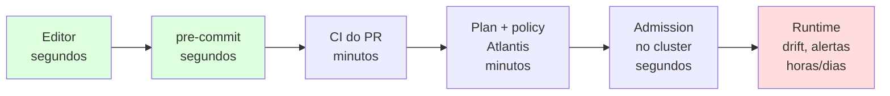

# Shift left: onde cada erro é pego (e quanto custa pegá-lo ali)

**Shift left** = mover a detecção de problemas para o **mais cedo possível** no ciclo de mudança. Quanto mais à direita um erro é encontrado, mais caro ele fica: mais gente envolvida, mais tempo, e no limite, o cliente afetado.



## As camadas neste lab

| Camada | Ferramenta | O que pega | Onde está |
|---|---|---|---|
| **1. Commit (local)** | **pre-commit** | Formatação (`terraform fmt`), sintaxe (`validate`), lint (`tflint`), **segredos (gitleaks)**, YAML inválido, chave privada, arquivo grande (tfstate/plan), commit direto na `main` | `.pre-commit-config.yaml` (este repo) |
| **2. PR (CI)** | GitHub Actions | Tudo da camada 1 (de novo: o hook pode ser pulado), mais **trivy** (IaC inseguro), `terraform test`, **paridade stg/prod**, `kubeconform` e **`istioctl validate`** nos manifestos, **CVE em dependências** (`trivy fs`) e na imagem, assinatura (cosign) | `terraform-workflows`, `.github/workflows/` de cada repo |
| **3. PR (plan)** | Atlantis + **conftest (OPA)** | O efeito **real** contra a nuvem (o plan), **tags obrigatórias**, **destruição de recurso protegido** (exige `approve_policies`), erros que só a API da AWS conhece (ex.: caractere inválido na descrição de SG) | `atlantis-server/policies` |
| **4. Merge** | Rulesets do GitHub | Merge só com checks verdes e (no `infra-live`) **depois do apply**; sem force push | `infra-live/github` |
| **5. Admissão (cluster)** | Webhooks (Istio), schema das CRDs, Pod Security | Configuração inválida que chegou até o cluster | Istio, Kubernetes |
| **6. Runtime** | Drift diário, alertas (Prometheus), Argo CD self-heal, scan do Aikido | Mudança feita por fora, regressão, CVE nova em algo que já estava aprovado | `drift.yml`, PrometheusRules, Argo CD |

## Erros reais deste lab e em que camada deveriam ter sido pegos

| Erro | Onde foi pego | Onde **deveria** ter sido | O que mudou |
|---|---|---|---|
| Output sem descrição (`tflint`) | 2. CI, depois de um plan | **1. pre-commit** | Hook `terraform_tflint` |
| `terraform fmt` desalinhado | 2. CI, depois de outro plan | **1. pre-commit** | Hook `terraform_fmt` |
| CVE HIGH no `golang.org/x/net` | 2. CI, no scan da **imagem** | **2. CI, no scan das dependências** (antes de buildar) | `trivy fs` no job de teste do `sample-app` |
| `>` na descrição da regra de SG | 3. plan (API da AWS) | 3: só a API sabe, e por isso o plan roda em todo PR | (correto como está) |
| VirtualService com `*` no mesh | 5. admissão no **stg** (por sorte) | **2. CI** (`istioctl validate`, sem cluster) | Step no CI do `sample-app-deploy` |
| Token do EKS expirando no apply | 3. apply | Revisão de design (ADR 0003) | Auth `exec` |

## Por que repetir no CI o que o pre-commit já faz

O pre-commit é **conveniência** (feedback rápido); o CI é **garantia**:

- `git commit --no-verify` pula os hooks.
- Alguém sem o `pre-commit install` não roda nada.
- Edição pela UI do GitHub não passa por hook nenhum.

Por isso o job `pre-commit` do CI roda **o mesmo arquivo** e o ruleset exige os checks para o merge. **Regra só vale se o servidor a impõe.**

## Boas práticas aplicadas no `.pre-commit-config.yaml`

| Prática | Por quê |
|---|---|
| `rev` fixado por **SHA** (`autoupdate --freeze`) | Tag pode ser movida para outro commit; SHA não. O hook roda código de terceiros na sua máquina, então é supply chain. |
| Mesmas versões do CI (terraform 1.17.2, tflint v0.66.0, mesmo `.tflint.hcl`) | Sem "passou aqui, falhou lá" |
| Hooks rápidos; trivy e testes só no CI | Hook lento vira `--no-verify` e deixa de proteger |
| `gitleaks` antes do commit | Segredo que entrou no histórico **precisa ser revogado**: apagar do Git não basta (clones, forks, cache) |
| `no-commit-to-branch main` | Lembrete local; quem garante é o ruleset |
| Atualização por PR (`pre-commit autoupdate --freeze`) | Ferramenta de verificação também é dependência, e muda com revisão |

## Como usar

```bash
# uma vez por máquina (venv isolado: o Python do sistema bloqueia pip global, PEP 668)
python3 -m venv ~/.local/venvs/pre-commit && ~/.local/venvs/pre-commit/bin/pip install pre-commit
ln -s ~/.local/venvs/pre-commit/bin/pre-commit ~/.local/bin/pre-commit
# tflint na MESMA versão do CI, conferindo o checksum
#   https://github.com/terraform-linters/tflint/releases/tag/v0.66.0

# uma vez por clone
pre-commit install

# no dia a dia: roda sozinho no git commit. Para rodar em tudo:
pre-commit run --all-files
```

## Resposta para a entrevista

> "I think about shift left as layers, each one cheaper than the next. Pre-commit hooks give feedback in seconds: formatting, lint, validate and secret scanning with gitleaks. CI repeats them, because hooks can be skipped, and adds the heavier checks: trivy on IaC and dependencies, tests, kubeconform and istioctl validate on rendered manifests. The Terraform plan runs on every PR with OPA policies, because some errors only the cloud API knows. Branch rules make the server enforce all of that. And runtime checks like drift detection catch what changes outside the pipeline. Every incident should move its detection one layer to the left."
